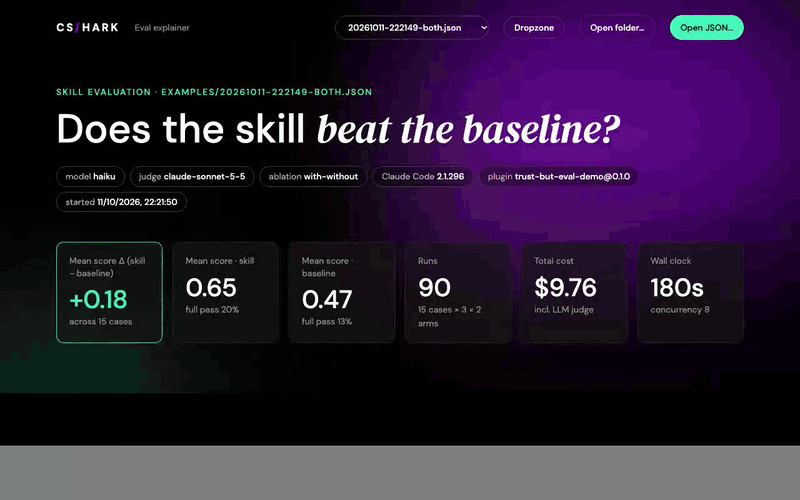
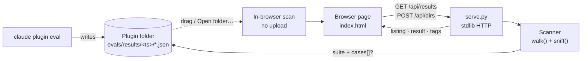

<div align="center">

# Trust, *but eval.*

**A local viewer for `claude plugin eval` results.**<br>
Point it at a plugin folder and it shows whether the skill beats its no-skill baseline, and why.




</div>

---

## Quick start

```bash
python3 serve.py --results ~/plugins/my-plugin --open
```

That's all it takes. The folder is scanned recursively, the eval output inside it
(`evals/results/<timestamp>/aggregate-result.json`) is found automatically, and
the newest skill-vs-baseline run opens. Python 3 only, nothing to install.

<table>
<tr>
<td width="33%" valign="top">

### 📂 Point at a folder
Use `--results DIR` (repeatable), type a path into **Add folder** on the page,
**Open folder…**, or just drag a folder in.

</td>
<td width="33%" valign="top">

### 🔍 Detected by shape
Any `.json` with a `suite` and a `cases` list counts as a result, whatever its
name or depth. `plugin.json`, broken JSON and `node_modules` are skipped.

</td>
<td width="33%" valign="top">

### 🔒 Stays on your machine
Binds to `127.0.0.1` and rejects foreign `Host` headers. Dropped files never
leave the tab. Docker mounts are read-only.

</td>
</tr>
</table>

## What you see

| Section | Answers |
|---|---|
| **Hero** | Model, judge, ablation and Claude Code version. KPIs: score Δ, the mean score of each arm, runs, cost, wall clock. |
| **01 Arm comparison** | Paired bars for score, full pass, deterministic pass, judge PASS, skill fired, cost, time and turns. |
| **02 Per case** | Baseline vs skill for every case, sorted by the gap, with happy / edge / adversarial tags. Click a case to drill in. |
| **03 Grader matrix** | Pass rate per case × grader, toggled between skill, baseline and Δ. |
| **04 Case detail** | Every run: grader verdicts (hover for the reason), judge votes, the answer and the prompt. |

> [!NOTE]
> Scores leave out the `skill-fired` grader, so both arms sit on one scale, even
> under `--ablation none`, where that grader is scored.

## Getting results in

```bash
python3 serve.py --open                                   # bundled examples
python3 serve.py --results ~/plugins/my-plugin --open     # plugin root, evals/ or evals/results/
python3 serve.py --results a/ --results b/ --cases path/to/evals/cases --open
```

| Way in | Scanned by | Notes |
|---|---|---|
| `--results DIR` | server | Repeatable. New runs show up on page reload. |
| **Add folder** (Dropzone panel) | server | Type any local path. It is remembered and re-added after a server restart. |
| **Open folder…** / drag a folder | browser | Nothing is uploaded. Works with `index.html` opened straight from disk. |
| **Open JSON…** / drag files | browser | A non-result file dropped on its own is listed with the reason. |

The dropdown groups results by folder, newest first. Case tags come from
`tags.json` and from the `tags: [...]` line of `evals/cases/<case>/prompt.md`
anywhere inside a scanned folder, or from `--cases DIR`.

<details>
<summary><b>Docker</b></summary>

```bash
docker compose up --build -d                                         # examples → http://127.0.0.1:8077
RESULTS_DIR=~/plugins/my-plugin docker compose up -d                 # scanned recursively
RESULTS_DIR=… CASES_DIR=~/plugins/my-plugin/evals/cases docker compose up -d
PORT=9000 docker compose up -d
docker compose down
```

The container listens on `0.0.0.0` inside, and the host publishes it on
`127.0.0.1` only. Folders are mounted read-only. **Add folder** can only reach
paths inside the container, under `/data/results`.

</details>

## How it works




There is an interactive, click-through version of this diagram, with four flows
and a Local/Docker toggle, in [`docs/architecture.html`](docs/architecture.html).
Open it locally (`open docs/architecture.html`). A text walkthrough of every flow
and the HTTP API is in [`docs/architecture.md`](docs/architecture.md).

## Examples

`examples/` holds two real runs of a `commit-message` skill: 15 cases, 3 runs per
arm, model `haiku`, judge `claude-sonnet-5-5`.

- `20261011-222149-both.json`: skill vs no-skill baseline (`--ablation with-without`).
- `20261011-222450-skill.json`: skill arm only (`--ablation none`).
- `tags.json`: the happy / edge / adversarial tags of those cases.

A file whose name ends in `-baseline.json` labels its single arm "baseline". The
prompts contain upstream patches from `vitejs/vite` and
`conventional-changelog/commitlint` (MIT).

## Files

```
index.html             the whole app: one page, inline CSS and JS
serve.py               stdlib HTTP server: scans folders for results, serves the page
Dockerfile             python:3.12-slim, runs as nobody
compose.yaml           localhost-only port, read-only result mounts
examples/              sample results and tags
docs/demo.gif          the app in action
docs/architecture.*    interactive diagram (.html), walkthrough (.md), recording (.gif)
```

<div align="center">
<sub>eval-explainer · <a href="https://www.cshark.com">CSHARK</a></sub>
</div>
