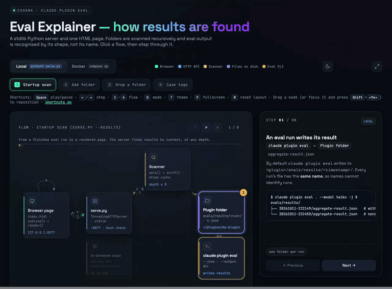

# Eval Explainer: architecture

How `claude plugin eval` results get from disk onto the page. The interactive
version is [`architecture.html`](architecture.html). Open it in a browser and
press <kbd>Space</kbd> to play, <kbd>1</kbd>–<kbd>4</kbd> to switch flows and
<kbd>O</kbd> to switch between Local and Docker.

## Components

| Component | What it is | Where |
|---|---|---|
| **Browser page** | `index.html`: one page with inline CSS and JS. `analyse()` recomputes the scores; `render()` draws the page. | `127.0.0.1:8077` |
| **serve.py** | A stdlib `ThreadingHTTPServer` with a JSON API. It only answers requests addressed to `127.0.0.1`, `localhost` or `::1`. | Local: `python3 serve.py`. Docker: `python:3.12-slim`, `USER nobody` |
| **Scanner** | `walk()` plus `sniff()`. It walks folders recursively up to depth 8, skips `.git`, `node_modules`, venvs and `dist`/`build`, and recognises results by their shape. Results are cached by mtime and size. | inside `serve.py` |
| **In-browser scan** | `openLocal()` plus the File and Directory Entries API, with the same rules as the Scanner. Files are never uploaded. | inside `index.html` |
| **Plugin folder** | Where results live, by default `<plugin>/evals/results/<timestamp>/aggregate-result.json`. | Local: any path. Docker: the `RESULTS_DIR` mount at `/data/results` (read-only) |
| **claude plugin eval** | Produces the result files (`--json`, `--output-dir`). | your machine or CI |

## HTTP API

| Method | Route | Returns |
|---|---|---|
| `GET` | `/api/results` | `[{id, name, root, rootLabel, startedAt, cases, ablation, plugins, size, mtime}]`, newest first |
| `GET` | `/api/result?id=<root>:<rel>` | The full result JSON. Only ids from the listing resolve. |
| `GET` | `/api/tags` | `{case: [tag, …]}` |
| `GET` | `/api/dirs` | The folders being scanned |
| `POST` | `/api/dirs` `{"path": "…"}` | `{root, label, found}`. The request must be `application/json`. |

## Flows

### 1. Startup scan (`serve.py --results`)
1. **claude plugin eval → Plugin folder:** the run writes `evals/results/<ts>/aggregate-result.json`. Every run uses the same file name.
2. **Browser → serve.py:** the page sends `GET /api/results` with the tags request.
3. **serve.py → Scanner:** every root is walked recursively.
4. **Scanner → Plugin folder:** each `.json` is parsed. It counts as a result only if it has a `suite` object and a `cases` list; everything else is skipped quietly.
5. **Scanner → serve.py:** each result gets an id of `<root index>:<relative path>`, and the list is sorted by `startedAt`.
6. **serve.py → Browser:** the dropdown groups results by folder. The page opens the hash target, else the newest *with-without* run.
7. **Browser → serve.py:** `GET /api/result?id=…`. If the file is gone, the page refreshes the dropdown instead.
8. **Browser → Browser:** `analyse()` and `render()`. The `skill-fired` grader is left out of the score, so both arms sit on one scale.

### 2. Add folder (`POST /api/dirs`)
1. **Browser → serve.py:** the path typed in the Dropzone panel is sent as JSON. Any other content type gets 415.
2. **serve.py → serve.py:** `add_root()` expands `~`, resolves the path and requires a directory. A bad path gets 400.
3. **serve.py → Scanner** and **Scanner → Plugin folder:** the same scan as at startup. A plugin root, `evals/` or `evals/results/` all work.
4. **serve.py → Browser:** the reply is `{root, label: "~/…", found}`. The page saves the folder in `localStorage["viz.folders"]` and re-adds it after a server restart.
5. **Browser → Browser:** the dropdown refreshes and opens the newest with-without run from the new folder.

### 3. Drop a folder (no upload)
1. **Plugin folder → In-browser scan:** a folder dragged onto the page is walked with the Entries API. **Open folder…** (`webkitdirectory`) hands over the whole tree at once.
2. **In-browser scan:** the same skips and shape check. Non-result files inside a folder are dropped silently; a single non-result file dropped on its own is reported.
3. **In-browser scan → Browser:** results appear under *Dropped*, keyed by relative path.
4. **Browser → Browser:** the page renders. This flow also works with `index.html` opened from disk.

### 4. Case tags (`GET /api/tags`)
Tags are merged from three places: `tags.json` anywhere under a root, the
`tags: [...]` line of every `cases/<case>/prompt.md`, and `--cases DIR`. A folder
opened in the browser contributes its tags the same way.

## Modes

| | Local | Docker |
|---|---|---|
| Start | `python3 serve.py --results DIR --open` | `RESULTS_DIR=… docker compose up -d` |
| Binds | `127.0.0.1:8077` | `0.0.0.0:8077` in the container, published on the host's `127.0.0.1:${PORT}` |
| Folders you can add | any path on your machine | only paths inside the container, under the `/data/results` mount |
| Files | read in place | mounted read-only |

## Security notes

- The server binds to localhost only, including under Docker.
- The `Host` allow-list blocks DNS-rebinding attacks.
- `POST` must be `application/json`. That forces a CORS preflight, which the server never answers, so other sites cannot add folders.
- File reads go through listing ids only, so path traversal is not possible.
- The server only ever serves files that parse as eval results, never arbitrary JSON.
